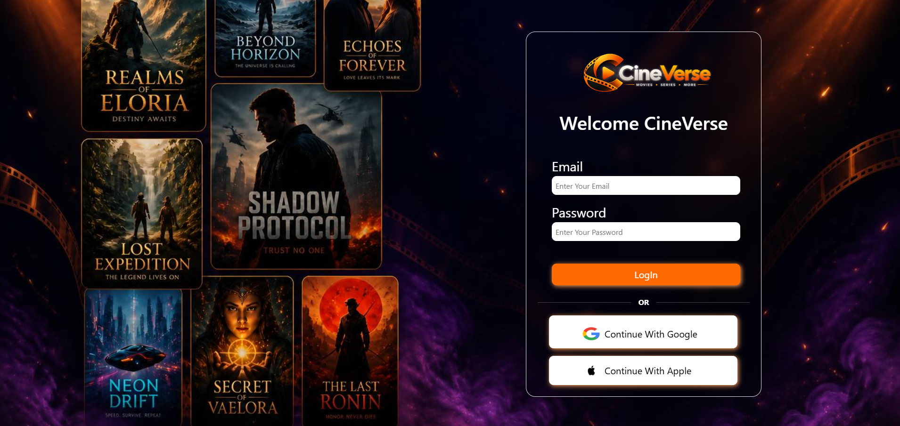
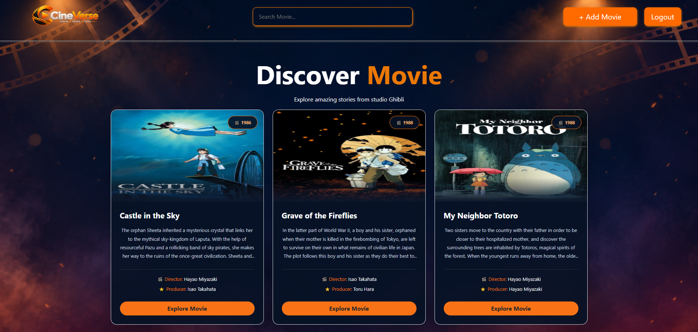
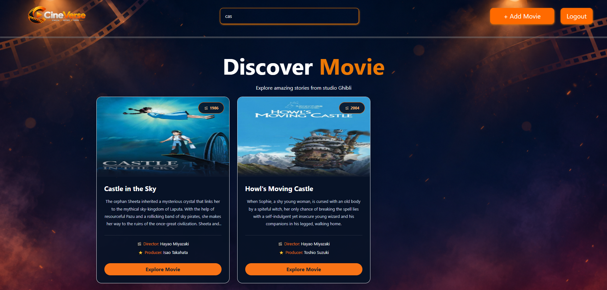
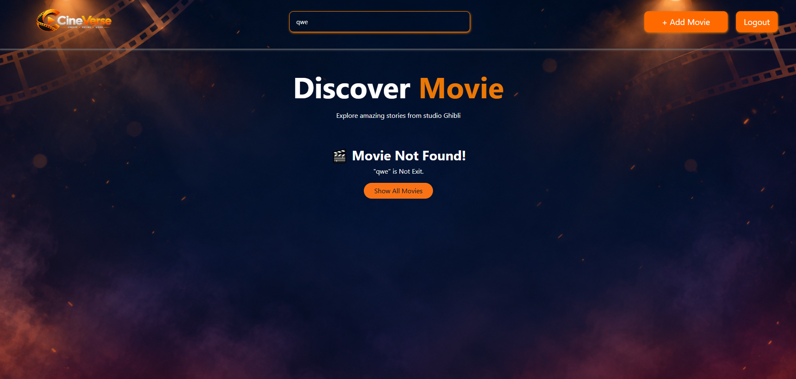
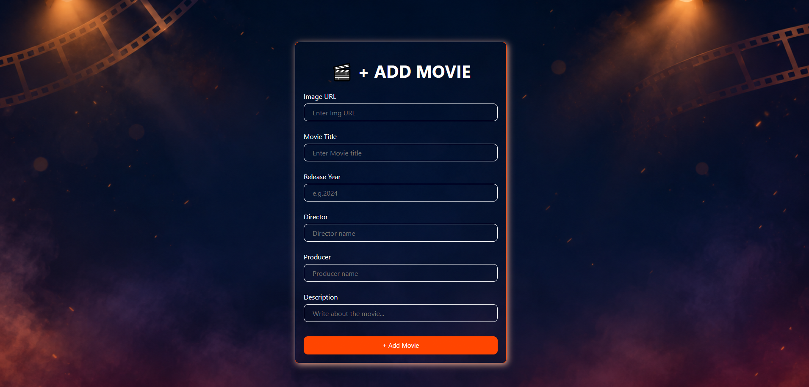

# 🎬 CineVerse — Movie Discovery App

This is a Movie Discovery App . This App name is CineVerse . This app build using ReactJs. Navigate , Routes , Protected Routes , Redux , Add and Searching ect. topics are cover. The application features a modern dark theme with orange accents and a cinematic background.  

## ✨ Features

🎥 Movie Collection

🔍 Search Movies

➕ Add New Movie

🔄 Redux State Management

🎨 Modern UI

🔐 Login Page

🚪 Logout

❌ No Movies Found

🧭 Navigation

## 🛠️ Technologies Used

React.js

JavaScript

Redux

React Redux

React Router DOM

Axios

Bootstrap

HTML5

CSS3

Vite

📂 Project Structure

CineVerse
- src

   - assets
      - logo.png
      - main.png

    - component
       - Login.jsx
       - MainPage.jsx
       - Form.jsx

    - Redux
       - action.js
       - reducer.js
       - store.js

    - page
       - vaildation.jsx

## 🖼️ Screenshots

### Login Page

### Main Page

### Searching Page

### No Data found

### Add form

